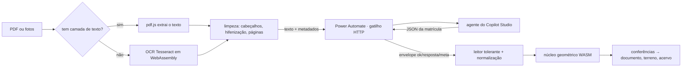

# MatReader

Transforma a **matrícula de um imóvel** em documento conferido, desenha o **terreno sobre o satélite**, junta PDFs e guarda tudo num **acervo local** — no navegador, no celular ou instalado como app, **mesmo sem internet**.

PWA em **Ionic 8 + Vue 3 + TypeScript**, com **WebAssembly** em três frentes (núcleo geométrico próprio, OCR e decodificadores de PDF). Visual "Papel & Tinta", inspirado no [Nomadic Tribe](https://2019.makemepulse.com/) da makemepulse: papel creme com grão, ardósia, traço de nanquim, janela em arco, setas desenhadas à mão e animações com função.

<p align="center">
  
  &nbsp;
  
</p>

## O que ele faz

| Bloco | Para quê |
|---|---|
| **Entrada** | Solte o PDF ou as fotos (no celular, **Fotografar** abre a câmera). Também aceita JSON colado, arquivo `.json` e um exemplo fictício. |
| **Jornada** | Acompanha a conversão estação por estação — arquivo, texto (PDF ou OCR), envio, agente, conferência — com tempo, histórico, o texto exato enviado e a resposta crua. **Testar conexão** confere o fluxo sem gastar o agente. |
| **Resumo** | Número, situação, área, vértices, donos, ônus e o placar das **conferências automáticas**. **Copiar resumo** gera um texto pronto para Teams ou e-mail. |
| **Terreno** | Polígono sobre o satélite (Esri) ou como desenho técnico (offline). Arraste para mover, pegador para girar, ajuste fino (giro exato, espelhos, opacidade, amarração). Exporta **KML, KMZ, Google Maps e croqui PNG**. |
| **Documento** | A matrícula montada por seções, com **busca dentro do texto**, cópia de códigos e impressão só do documento (com croqui). |
| **Juntar PDFs** | Fila local de PDFs e imagens, reordenável (Ionic Reorder), com opção de remover links (cada página vira imagem). |
| **Acervo** | Toda matrícula com número fica salva no aparelho (IndexedDB), com selo de estado, busca, ordenação, **backup**, **restauração** e **planilha CSV**. |
| **Editor JSON** | O que a IA devolveu, editável; o documento remonta sozinho. |

### Conferências automáticas (o "CoVe" do app)

A IA pode errar em silêncio, então o app refaz o que dá para refazer: dígito de CPF/CNPJ, mesmo documento com nomes diferentes, soma das participações, situação da matrícula, cronologia e datas no futuro, ônus ativo com ato cancelado, **fechamento e autointerseção do polígono**, área e perímetro calculados × declarados (inclusive a área georreferenciada), vértices declarados × extraídos, coordenadas dentro do Brasil, **resposta da IA cortada**, **texto truncado no envio** e **confiança do OCR**.

## Arquitetura

```
src/
├─ core/          utilidades puras (formatação BR, texto, navegador)
├─ domain/        regras de negócio, sem DOM — testáveis
│  ├─ matricula/  tipos, leitor de JSON tolerante, normalização, conferências, resumo
│  ├─ geo/        azimutes/rumos, DMS, UTM, geometria, contrato do núcleo geométrico
│  ├─ export/     KML, KMZ (zip feito à mão), CSV
│  └─ prompts/    prompts de extração (.txt, também lidos pelo gerador do scope)
├─ wasm/          carregador do núcleo geométrico em WebAssembly (+ geometry.wasm)
├─ services/      efeitos colaterais: pdf.js/pdf-lib, OCR, extração de texto,
│                 cliente do fluxo, IndexedDB, geocodificação, PWA
├─ stores/        estado (Pinia): matrícula, acervo, fila, jornada, terreno, interface
├─ app/           comandos centrais (actions), navegação, impressão, atalhos
├─ features/      montagem do documento e pintura do terreno
├─ components/    ink/ (sistema visual) · panels/ (os 8 blocos) · terrain/ · dialogs/ · layout/
├─ views/         casca (bento no desktop, abas Ionic no celular)
└─ styles/        tokens, tema Ionic, base, documento, impressão
wasm/geometry/    fonte AssemblyScript do núcleo geométrico
tests/            Vitest: domínio e paridade WebAssembly × TypeScript
scripts/          vendor (recursos offline), ícones (resvg-wasm), scope do Power Automate
power-automate/   modelo do scope para colar no Power Automate
```



**Layout:** no desktop (≥ 992 px) tudo fica visível numa página só (bento em 12 colunas; a primeira fileira é o tríptico com a Entrada em arco no centro). Abaixo disso, abas Ionic — Início, Documento, Terreno, Arquivos, Acervo — com alvos de toque de 40–44 px.

## WebAssembly

1. **Núcleo geométrico próprio** (`wasm/geometry`, AssemblyScript → `src/wasm/geometry.wasm`, ~6 KB): caminhada por azimutes, área (fórmula do laço), perímetro, autointerseção e conversão UTM → geográficas em lote. A versão TypeScript é reserva e referência; os testes conferem as duas lado a lado.
2. **OCR** — Tesseract (núcleo LSTM com e sem SIMD + português) servido de `public/vendor/ocr`, sem CDN.
3. **pdf.js 5** com os decodificadores WebAssembly (JPEG 2000, JBIG2, cores ICC) em `public/vendor/pdfjs`.

Os ícones do PWA também são gerados com **resvg em WebAssembly** (`npm run icons`).

## Offline

- O service worker (Workbox) guarda o app inteiro na primeira visita: abre sem internet, com acervo, documento, desenho do terreno, PDFs e impressão.
- OCR e recursos do pdf.js (~11 MB) entram no cache no primeiro uso — ou de uma vez em **Configurações → Preparar uso offline**.
- Os tiles do satélite já vistos ficam em cache; sem rede, o Terreno mostra o desenho técnico.
- Instalado, o app abre PDFs e JSON direto pelo sistema (File Handling API).

## Integração com o Power Automate

O app extrai o texto no aparelho e envia só o texto ao seu fluxo. Contrato `matreader/fluxo@2`:

```jsonc
// pedido (POST)
{ "contrato": "matreader/fluxo@2", "app": { "nome": "MatReader", "versao": "4.0.0" },
  "filename": "…", "texto": "=== Página 1 ===\n…", "paginas": 3, "metodo_texto": "pdf-texto | ocr | misto",
  "ocr_confianca": 91, "caracteres": 18234, "sha256": "…", "base64Encoded": "… (só para o fluxo antigo)" }
// resposta
{ "ok": true, "versao": "mat-flow/2.0", "resposta": "<texto do agente com o JSON>", "meta": { … } }
{ "ok": false, "mensagem": "…", "detalhe": "…", "etapa": "…" }
// teste de conexão
{ "ping": true }  →  { "ok": true, "pong": true, "versao": "…", "agente": "…" }
```

Passo a passo em [`power-automate/README.md`](power-automate/README.md). O app também aceita o fluxo antigo (resposta = JSON direto) e a resposta assíncrona do Power Automate (202 + `Location`).

## Desenvolvimento

Requisitos: Node 22+ (24 recomendado).

```bash
npm install
npm run dev          # copia os recursos offline e sobe o Vite em http://127.0.0.1:5173
npm test             # Vitest: domínio + paridade WebAssembly
npm run lint         # ESLint (Vue + TypeScript)
npm run typecheck    # vue-tsc estrito
npm run build        # vendor → wasm → tipos → build + service worker (dist/)
npm run preview      # serve o build em http://127.0.0.1:4173
npm run build:wasm   # recompila o núcleo geométrico (AssemblyScript)
npm run icons        # regera os ícones do PWA
npm run scope        # regera o modelo do scope do Power Automate
```

**App nativo (Capacitor):** `npx cap add android` (ou `ios`), depois `npm run build && npx cap sync`.

## Publicação

O workflow **Publicar no GitHub Pages** (`.github/workflows/pages.yml`) gera o build com `BASE_PATH=/matreader/`. Ative em *Settings → Pages → Source: GitHub Actions* e rode o workflow. A CI (`ci.yml`) roda lint, tipos, testes e build a cada push.

## Privacidade

Saem do aparelho apenas: o **texto da matrícula** (para o seu fluxo), as **imagens de satélite** e a **busca de endereço** (Nominatim). Documento, OCR, acervo, PDFs e impressão acontecem no aparelho. A URL do fluxo fica só no navegador do usuário — nunca no código.
